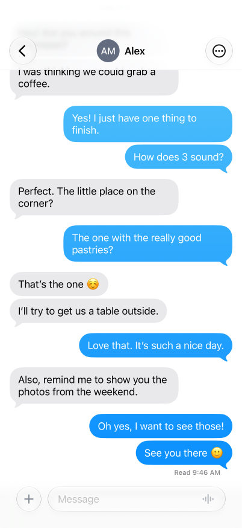
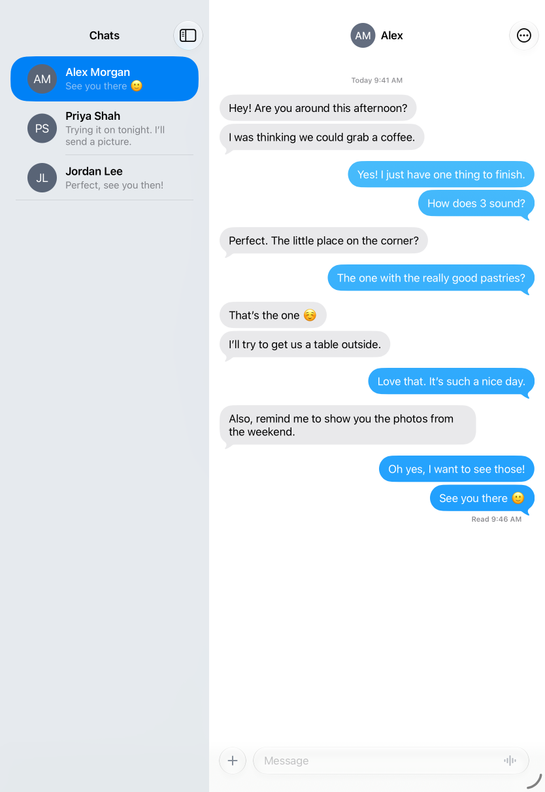

# Chat

A chat app: a list of conversations, and a conversation's transcript over a composer that rides on the keyboard. Conversations and drafts are saved on the device; there is no server or account.

Keywords: chat, messaging, messenger, conversation, inbox, thread, transcript, message bubbles, balloons, tails, composer, text input over the keyboard, input accessory, keyboard avoidance, interactive keyboard dismissal, swipe down to dismiss the keyboard, virtualized list that follows its end, load earlier messages, typing indicator, read receipt, delivered, reply, swipe to reply, long-press menu, copy, delete, context menu, peek, preview, popover, Liquid Glass, glass group, blur under a bar, split view, sidebar, list and detail, drafts, local persistence.

## What it shows, and where

| Behaviour | Where |
| --- | --- |
| The conversation list: avatar, name, when the last message was sent and the message itself, lines from the text, a long press that peeks at the conversation; at the accessibility text sizes no avatar | `app.contract`, the `inbox` route, `ConversationRow` and `id="conversation-peek"` |
| The bar's search field: the conversations whose name matches, then the messages whose text does, each in a balloon trimmed around its match to whole words, the match in a stronger colour; "No Results" over the empty list, above the keys while the search is typed in | `app.contract`, `searchChats`, `shown`, `matches` and `noResults`; `model.ts`, `found` and `snippet`; `app.ts`, `searchMessages` |
| List beside the conversation on an iPad, the iPhone Duo open, or a window 900 px wide, from the first frame, with the conversation last opened open there at launch, else the newest; a pushed conversation on a phone, which opens at the list | `app.contract`, `routes`, `follow`, `selected`, `task select` and `reopen`, and `navigationSplit` on the list's route; the rows are links |
| A transcript that opens at its newest message and follows it, built only where it shows | `app.contract`, `list id="transcript"` (`virtualized`, `scroll-start="end"`, `scrollFollowEnd`) |
| A conversation loaded from its store as it is read, as ChatKit loads one: it opens at its latest 50 messages, which the list answers with it, and loads 50 more at each edge the reader reaches, at most 200 at once; the receipt, choosing and search read only what is loaded | `app.contract`, `loaded`, `window`, `older`, `newer`, `latest` and `reachstart`/`reachend`; `model.ts`, `viewing`, `loadMore`, `kept`, `window` and `inbox`; `app.ts`, `loadTranscript` |
| 240 earlier messages put above the reader without moving what they read | `app.contract`, `action history` |
| Balloons with tails, grouped in runs from one side a minute or less apart, a one-letter balloon's text centred; the time stamp over a conversation's first message and after an hour's gap; the read receipt; the typing indicator | `bubble.contract`, `Balloon`, `MessageRow`, `stampDay`, `Typing`; `model.ts`, `present` |
| A message's long-press menu (Reply, then Copy and More…) and swipe to reply. More… chooses messages to delete or share: a mark beside each row, Cancel in the bar, Delete and Share where the composer was, and an action sheet before deleting; a deleted message fades as the rows before it come down over it | `bubble.contract`, `contextmenu`, `swiperight` and `MessageRow`'s `choosing`; `composer.contract`, `ChoiceBar`; `app.contract`, `id="message-menu"`, `id="delete-messages"`, `choosing` and `chosen` |
| A long press on the contact in the bar: their photo, alone and larger, over Call, FaceTime and Mail; one on a person's avatar in the list: their card, as wide as a row, with their avatar and name, over Message, Call, Video and Mail. Call, FaceTime, Video and Mail link to their fictional number and address | `app.contract`, the `contact` button's `contextPopover` and `id="contact-menu"`, the avatar's `contextmenu`, `card` and `id="person-card"`; `model.ts`, `contacts`; `app.tamber`, the Call and Video icons off Apple |
| The composer: a growing field in a glass pill, a glass + beside it in one glass group, a blur behind the bar, Send | `composer.contract`, `Composer` |
| The composer on the keyboard, and the keys' interactive dismissal | `composer.contract`'s padding and comment; `keyboardDismissMode="interactive"` on the transcript |
| A flick down on the bar, or on its field while its text fits, putting the keys away (iOS; Android's fling and the Mac's three-finger swipe make it there too) | `composer.contract`, `swipe=hideKeys swipe-direction="down"` on `composer-bar`, `hideKeys` |
| The + card that opens over the keyboard | `app.contract`, `id="add-menu"`; `types.contract`, `CardRow`, `CardTile`, `CardGlyph` |
| A send's flight from under the field's glass to its row on the platform's springs, the message in the transcript from the send, before it is saved, the transcript scrolling to make room, the tail of the balloon before shrinking into it, and a received message popping in | `app.contract`, `action send`, `action animate`, `action rise`, `id="send-flight"`; `app.ts`, `overlay`; `types.contract`, `keyframes arrive` |
| Saving every conversation in one file and the drafts in another, so that typing rewrites only the drafts, one write at a time, the files read once | `app.ts`, `answer`, `load` and `drafts`; `model.ts`, the people and seeded conversations |

## Files

`app.contract` holds the routes, the conversation and its state, the send animation and the popovers. `bubble.contract` draws the rows. `composer.contract` is the composer. `types.contract` has the shared shapes, styles and keyframes. `app.ts` is the data module; `model.ts` has the people, their seeded conversations and the saved file's shape. `app.test.contract` drives the UI on every host; `app.test.mjs` tests saving with `bun test`. `art/AppIcon.icon` is the icon for iOS and macOS, `assets/icon.png` for the web.

## Adapt

- People and history: `contacts` and `seedConversation` in `model.ts`. How much a transcript loads: `viewing`, `loadMore` and `kept` there. A real service replaces `answer` in `app.ts`; the contract reads it through `loadInbox` and writes through `command`. `overlay` shows a sent message until the answer has it, under the id `answer` gives it: `sent-` and one more than the conversation's `serial`, which `action send` names too.
- To drop a feature, delete its piece and the state only it uses: the peek (`conversation-peek`, `peek`, `resetPeeked`, the rows' `contextmenu`), the contact's menu (`contact-menu`, the `contact` button's `contextPopover`), the person's card (`person-card`, `carded`, `card`, the avatar's `contextmenu`), choosing messages (`choosing`, `chosen`, `more`, `choose`, `endChoosing`, `deleteChosen`, `shareChosen`, `ChoiceBar`, `delete-messages`, the rows' marks, and give the balloon's menu a Delete row in place of More…), the + card (`add-menu`, `receive`, `toggleTyping`, the `Card*` styles), the send's flight (the `flight*` states, `animate`, `rise`, `send-flight`, `handOff`), earlier messages (`history`, the `conversation-menu` row).
- `app.json`'s `verify.accept` explains the two findings `bun exact.mjs verify` reports: the sent balloons' contrast and the field's height.

## Verified

At Exact `ad181418b3`, `bun test`, `bun exact.mjs test web`, and `bun exact.mjs test ios` on an iPhone 18 Pro (iOS 27.0), an iPad Pro 11-inch (iOS 27.0) and an iPhone Duo (iOS 27.1, closed) simulator passed, as did an app made from this template with `new.mjs` on the iPhone and the iPad.

At `4b7d8dfa08`, an app made from this template with `new.mjs` passes `bun test`, `bun exact.mjs test web` and `bun exact.mjs test ios` on an iPhone 18 Pro (iOS 27.0) simulator; the iPad and the Duo were not run again. `bun exact.mjs verify` and `bun exact.mjs verify ios` both exit 0, but that exit covers the tests, not every finding: the web report lists 41 problems and the iOS report 13, which Limits describes. On the same simulator, opened at `/conversations/alex` with the platform's timing and touches and filmed in real time, a draft typed before the + card opened and a message received from it are both in the saved conversation, and the settled frame shows the draft, its caret and the software keyboard back. (That drive's own final check read the first row of the inbox, which by then was another conversation, so the drive itself is not counted as a pass.)

At `adc8447a88`, three commits on `4b7d8dfa08`, the same app passes `bun test`, `bun exact.mjs test web` and `bun exact.mjs test ios` on the iPhone 18 Pro (iOS 27.0) simulator; `verify` was not run again. On an iPad Pro 11-inch (iOS 27.0) simulator, a conversation chosen while the split shows "No Selection" has its balloons at their places from the selection's first frame. On the iPhone, a 252-message transcript opens with no frame showing its rows out of place, and a send and its delivered receipt each move the transcript's rows once, on one spring.

At `22b224a128`, which `exact.json` pins, an app made from this template with `new.mjs` passes `bun test` and `bun exact.mjs test web`, and `bun exact.mjs test ios` on the iPhone 18 Pro and iPad Pro 11-inch simulators (iOS 27.0). On the open iPhone Duo simulator (iOS 27.1), with 30,000 messages seeded in one conversation, 30 fast flings toward its top load 50 earlier messages about once a second until the last fling, 15 pages, each landing with the reader's row held; across 621 frames no step of a fling is over 493 points.

At `5afdec9cc7`, an app made from this template with `new.mjs` passes `bun test` and `bun exact.mjs test web`, and `bun exact.mjs test ios` on the iPhone 18 Pro and iPad Pro 11-inch simulators (iOS 27.0). On the iPhone, a conversation of 252 messages loads 50 more as the reader drags toward its top, with no frame showing the rows out of place, and a long press lifts a balloon centred where it shows. An app with 30,000 messages seeded in one conversation opens it at once on the iPhone simulator, on its first launch and after a relaunch, with no turn of the data module over its budget.

At `0611da8b12`, an app made from this template with `new.mjs` passes `bun test` and `bun exact.mjs test web`, and `bun exact.mjs test ios` on the iPhone 18 Pro (iOS 27.0) and iPad Pro 11-inch (iOS 27.0) simulators. On the open iPhone Duo (iOS 27.1) 13 of 14 pass: the agent cannot tap Options in the split's expanded column (`QUEUE.md`). On all three, the balloons, stamps, receipts, the composer's + and field, and the choosing marks are laid out where they were at `adc8447a88`, with the keys up and down. Filmed in real time on the iPhone, four sends in a row each move the transcript once, on one spring, and the typing indicator, a received message and a deleted one move it smoothly.

The macOS, Linux and Android builds have not been run.

## Needs

Exact at `22b224a128`, which `exact.json` pins: branch `chat/runtime-20261109` of github.com/ide/exact2, which is Exact's main at `41f28bca4e` with the eighteen pull requests `QUEUE.md` lists, the safe-area prototype (`proto/safe-area-live`) and fixes for their merge. None of these is on Exact's main yet. The route lays its content out in its safe area, takes its bottom edge for the composer (`-exact-safe-area="ignore bottom"`), and pads what lines up with the balloons by its layout margins (`var(--exact-layout-margins-inset-left)`), which the prototype adds. The template relies on what the pull requests add:

- The composer: the + card over the keyboard, which keeps the field's editing and selection while it stands the keys down and returns them when it closes; cards queued behind a closing card or returning keys, which wait for those to finish; plain, manual and nested popovers opened inside the card, shown in it; glass that answers a finger around a field and lets go when the field stops taking part; a material's gradient mask whose stops move with its frame; a field that scrolls only once its text overflows; and the keys counted once in the safe area of a route whose search is in the bar, taken down by a drag from the top of that bar or of the composer, or by a swipe down the search field, which keeps the search and its text.
- The list: the sidebar's lines and its highlight, which stays in the tint while the app is in the background and moves to a conversation its peek opens; the selected row's text in the colours the platform's own selected cell takes; a held row's press, which leaves a sidebar row that peeks as it is and ends when its window goes; and the split's columns following a row's press after the Duo folds, goes Back and unfolds.
- Long presses: a row's peek, which lifts the row with its cell, in a sidebar's rounded shape on the sidebar's ground or across a phone's width past its side safe area, and grows into the conversation it opens in place of the open one; the contact's in the bar's title, which lifts its avatar alone; a balloon lifted in its own outline, tail included; and links among a context menu's rows.
- The transcript: its keyboard, inset and rubber band handling; its glide to an end that moved up (a typing indicator hiding, a message deleted); rows that move from where they showed as a deleted message fades; a balloon's opacity set in the resize round that measures it; balloons placed without their layout transition where the route's own layout margins put them, which the host tells after the route's first layout (a conversation first chosen beside the list); rows mounted above the reader at sizes other than the estimate, with the extent and the anchor's correction those sizes make in the same batch; rows a commit moves (a send, a receipt, a run's spacing) moved from where they showed on one spring, the end followed at once; a header avatar drawn with its gradient and rounded initials; and the first screen's lists built for the window's size, not a default.
- `verify`'s acceptance of a list row's finding by its templated testId.

## Limits

`QUEUE.md` has what is left to do.

- The + is a 40-point target; `verify ios` reports it under the 44-point minimum.
- Five type sizes are fixed and do not grow with Dynamic Type (`app.contract:387` and `:447`, `bubble.contract:160`, `composer.contract:81` and `:83`). Both `verify` runs report them.
- At the largest text size on the web, the list's names are clipped, the page runs past the viewport's side, and the bar's contact, the Cancel of choosing and the send's flight overlap or overflow what is next to them.
- With the contact's menu open, both `verify` runs find its rows over the transcript and the list beneath: at the largest text size on iOS, and at the default size on the web. The web run also finds the bar avatar's initials under the 4.5:1 contrast minimum. The iOS menu's largest-text layout remains unqualified: the report alone cannot distinguish intended occlusion from a misplaced menu.
- An upright iPad shows the platform's "No Selection" beside the list at launch. The app opens a conversation there from 900 points wide, the width the web splits at, because it is not told whether the platform's split shows the list beside a conversation.
- A wrapped balloon is as wide as its maximum, not its longest line. The field grows only to its maximum height.
- Hardware and floating keyboards are untested. Cancelling an interactive dismissal of a custom card at zero progress is unqualified: a plain UIKit controller stalls there too.
- A card on an external screen and the first frame the compositor shows are unchecked.
- The runner's and the native host's first-batch tests pass, but the probe that counts the first screen's boot work cannot attribute its count to the boot alone.
- Video is a FaceTime link, which only Apple devices open.
