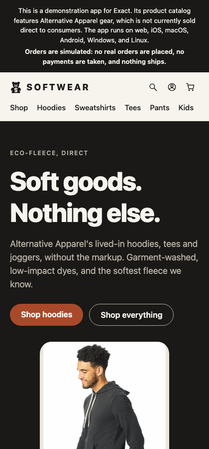
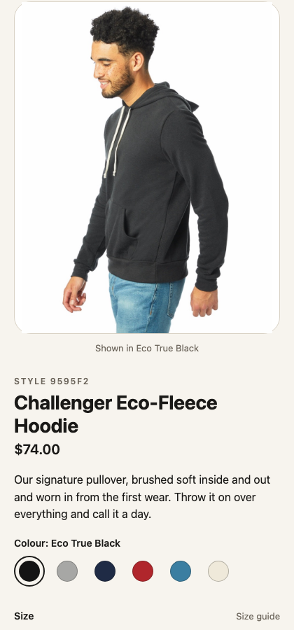

# Softwear

A clothing store for the web and installed apps: a searchable catalogue, product photos, size and colour choices, a saved bag, checkout and an account. A Bun and SQLite API supplies inventory, discounts and demo orders. Based on [ccheever/softwear](https://github.com/ccheever/softwear) at `1949c46`.

Keywords: store, shop, shopping, ecommerce, clothing, apparel, catalogue, catalog, product, inventory, stock, size, colour, filters, search, bag, cart, checkout, promo code, discount, account, orders, favorites, saved styles, photo gallery, pinch zoom, view transition, native module, REST, SQLite, server rendering, tabs, dark mode.

## What it shows, and where

| Behaviour | Where |
| --- | --- |
| Home, catalogue and story pages rendered at build time; product pages rendered per request | `app.contract`, `routes` and `render`; `catalog.ts`, `CATALOG` |
| Category, audience, size and price filters kept in the URL; search | `app.contract`, `setCat`, `setGender`, `setSize`, `setSort`, `search` |
| Product photos, colour and size choices, saved styles and related products | `app.contract`, `Photo`, `Frame`, `pickColor`, `pickSize`, `toggleSaved` |
| Stock checked across bag lines; server-priced discounts and inventory transactions | `app.ts`, `loadBagStock`, `checkPromo`, `placeOrder`; `server.ts` |
| Checkout that preserves subsequent bag edits while a reply is pending | `app.contract`, `placeOrder`; `tools/browser.test.ts` |
| Membership, restock requests, order history and retryable order failures | `app.ts`, `subscribe`, `notifyMe`, `loadOrder`; `regressions.test.contract` |
| Native tab stacks, haptics and photo navigation transitions | `app.contract`, `navigationSource`, `sharedElement`, `haptic` |
| Pinch, pan and double-tap photo zoom, with pull-to-dismiss on web and iOS | `modules/`, the `zoom-image` native view |
| Brand colours and bear mark in light and dark mode | `app.tamber`, `assets/brand/`, `tools/logo.ts` |

## Files

`app.contract` contains the pages and state; `app.ts` calls the API. `catalog.ts` supplies the products, and `server.ts` implements the demo API. `assets/` contains the shipped photos and brand; `photos/` retains original images and source manifests. `modules/` implements the photo viewer for Apple, Android and web hosts. `app.test.contract` and `regressions.test.contract` drive the UI; `tools/` contains isolated API and browser regression checks. `app/README.md` describes the app in more detail.

## Adapt

Create a copy with `bun new.mjs softwear <path> --name <name> --bundle-id <id>`. In that app:

- Run `bun server.ts`, then `bun exact.mjs web` in another terminal. `.env` defaults to a local API on port 8787. Set `API_BASE_URL` in the environment or `.env.local` before building for another server; a physical phone needs a reachable address.
- Replace `CATALOG`, the product images, the copy in `app.contract`, and the brand in `app.tamber` and `assets/brand/`.
- Replace demo sign-in and checkout with your authentication and payment service before using real customers or orders.
- Run `bun test tools/server.test.ts tools/data.test.ts` for isolated API tests. For browser regressions, set `EXACT2` to your Exact checkout, run `bun exact.mjs web-build --out target/browser-test`, then `EXACT_WEB_DIST=target/browser-test bun test tools/browser.test.ts`.
- `bun exact.mjs verify` starts an isolated API itself. If the default API port is already occupied, give verification a free port with `API_BASE_URL=http://127.0.0.1:18789 bun exact.mjs verify`.
- To put the app on someone's iPhone, host `server.ts` where a phone can reach it (it needs Bun and a disk that keeps `data.db`; set `API_BASE_URL` on the server to `http://0.0.0.0:<port>` and it listens there), then run `API_BASE_URL=https://<your server> bun exact.mjs share`, which prints an AppDrop link. The build is a release, so it needs `deploy.signing.keys` in `app.json`, or `"deploy": { "store": { "ios": "0" } }` for a build that takes no over-the-air updates.

## Verified

A fresh app created with `new.mjs` on the pinned Exact passes all 28 web UI tests, 5 API/data unit tests (89 assertions), and 4 browser regression tests. `bun exact.mjs verify` reports 16 findings: 12 overlaps at the largest text size involving the added-to-bag toast and product content; a DOM adoption refusal; two deliberately failed network replies from regression tests; and the failed stock resource those tests exercise. Reload checks report no findings. The template is not claimed to pass the full verifier. The app builds for the iOS simulator (`bun exact.mjs ios`) and for iPhone (`bun exact.mjs share`), but its tests have not been run on a native host.

## Needs

Exact `1cbce180d4256414368de13d39d5e3ff01292f1c`, pinned in `exact.json` on the published `main` branch of `expo/exact`. Bun runs the API and its SQLite database. Browser regression tests use the Exact checkout's Playwright installation. Apple and Android builds require their platform toolchains.

## Limits

This is a demonstration, not a production commerce backend: email-only sign-in has no authentication, checkout takes no payment, and restock subscriptions send no email. Product descriptions and retailer photos describe Alternative Apparel; the demo is not affiliated with it. Photos are retained for demonstration with their source manifests; replace them for your own store. Android and macOS are implemented but not certified by this template's checks. `QUEUE.md` lists follow-up work.
